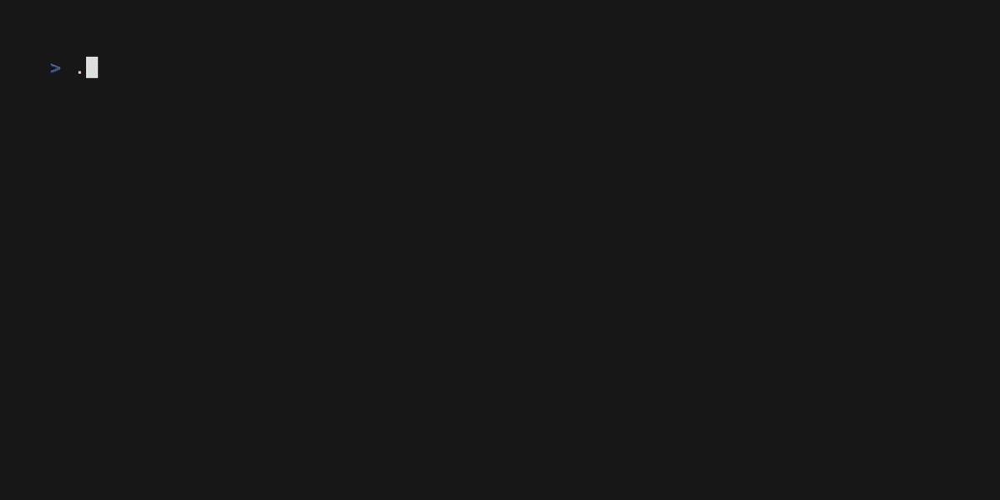

# DockStack

TUI (terminal) en Go pour gérer des stacks Docker Compose : lister les stacks
détectées, les démarrer/arrêter/redémarrer/recréer, pull les images, suivre
les logs, et capturer/restaurer l'état des stacks en cours d'exécution.



## ⚠️ Avertissement important

**Ce projet est entièrement vibecodé** : tout le code a été généré par un
agent IA (Claude / Claude Code), aucune ligne n'a été écrite à la main par un
développeur humain.

Je relis et corrige au fur et à mesure les bugs que je rencontre dans mon
usage quotidien.

**Utilisez ce projet à vos propres risques**, idéalement sur un environnement
où une erreur n'a pas de conséquence grave. Relisez le code vous-même avant
de l'utiliser sur des stacks importantes.

## Fonctionnalités

- Liste des stacks Docker Compose détectées, groupées par dossier, avec état
  (running / stopped / unhealthy) et compte de conteneurs
- Actions : Up, Stop, Down, Restart, Recreate, Pull, Remove (avec
  confirmation), Logs, avec les mêmes lettres dans la liste, le mode services
  et le panneau d'actions
- Actions groupées sur une sélection multiple ou un dossier entier
- Volet de détail à droite de la liste : services (problèmes en premier),
  état et actions adaptées ; `tab` bascule vers le fichier compose
- Gestion **service par service** (`→`, `←` pour sortir) : cocher des services, les
  filtrer (`/`), cocher ceux en défaut (`e`), puis stop / up / restart /
  recreate / pull / logs sans toucher aux autres. Image, ports et statut
  Docker du service sous le curseur ; avertissement si une dépendance est
  arrêtée (`+` pour l'inclure)
- Avant un `up` sur une stack en marche, prévision des services qui seront
  recréés (config modifiée, image mise à jour) ; rien à recréer = pas de
  confirmation
- Vue de progression en temps réel pendant les opérations, façon
  `docker compose` en CLI
- Captures d'état (`b`) : mémorisent quelles stacks **et quels services** tournent
  (jamais leurs données). Restauration sélective : seules les stacks à
  relancer sont cochées, les services arrêtés volontairement ne sont pas
  relancés. `i` met l'état actuel à l'identique d'une capture (démarre ce qui manque,
  arrête ce qui n'y figure pas, après confirmation). `n` nomme une capture,
  `*` l'épingle (jamais supprimée par la rotation). Un bandeau rappelle,
  au lancement, les stacks de la dernière capture qui ne tournent plus
- Filtrage / recherche dans la liste des stacks

## Prérequis

- Accès au socket Docker via le groupe `docker`
  (`sudo usermod -aG docker $USER`) — **ne pas lancer DockStack avec `sudo`** :
  `~/.dockstack` serait créé en root et les captures ne pourraient plus y être
  écrites. Le binaire utilise l'API `docker/compose/v5`, pas le binaire
  `docker compose`.
- Pour compiler depuis les sources : Go 1.26+

## Installation

Binaire statique Linux (amd64 ou arm64), sans dépendance :

```bash
curl -L https://github.com/Bloopps/DockStack/releases/latest/download/dockstack-linux-amd64 -o dockstack
chmod +x dockstack
./dockstack
```

Pour arm64, remplacer `dockstack-linux-amd64` par `dockstack-linux-arm64`.

## Lancer depuis les sources

```bash
go run ./cmd/dockstack
```

## Configuration

Fichier `~/.dockstack/config.json` (créé automatiquement au premier
lancement) :

```json
{
  "stack_dir": "/chemin/vers/vos/stacks",
  "max_parallel": 4
}
```

- `stack_dir` : dossier racine scanné pour trouver les fichiers
  `compose.yaml` / `compose.yml` / `docker-compose.yml` / `docker-compose.yaml`
  (un seul par dossier, dans cet ordre de priorité, comme la CLI)
- `max_parallel` : nombre d'opérations simultanées lors des actions groupées
  (défaut 4, aussi utilisé si la valeur est absente ou à 0)
- `show_all` : afficher aussi les stacks qui ne tournent pas, arrêtées ou
  jamais déployées (défaut `false` : seules celles qui tournent sont listées ;
  bascule avec `a`). Remplace l'ancien `show_inactive`, ignoré
- `exclude` : chemins relatifs à `stack_dir` ignorés par le scan, avec tout
  ce qu'ils contiennent (ajout avec `x` ; retirer l'entrée pour annuler),
  par ex. `["dockerstack", "tests/fixtures"]`

## Raccourcis principaux

| Touche                | Action                                              |
|-----------------------|-----------------------------------------------------|
| `u` / `s` / `d` / `r` / `c` / `p` | Up / Stop / Down / Restart / Recreate / Pull |
| `l`                   | Logs de la stack courante                            |
| `↩`                   | Panneau d'actions (mêmes lettres, plus Remove)       |
| `␣`                   | Sélectionner                                         |
| `ctrl+a`              | Tout sélectionner (visible)                          |
| `esc`                 | Désélectionner / fermer                              |
| `←` / `→`             | Sortir / entrer : dossier, ou services d'une stack   |
| `g` / `G`             | Haut / bas (liste, logs, progression, captures…)     |
| `/`                   | Filtrer                                              |
| `v`                   | Fichier compose en plein écran (`tab` : dans le volet) |
| `R`                   | Rafraîchir (auto sur événement Docker + toutes les 60 s) |
| `b`                   | Captures d'état (`c` capturer, `↩` relancer, `i` à l'identique, `n` nommer, `*` épingler, `del` ou `⌫` supprimer) |
| `a`                   | Afficher / masquer les stacks arrêtées et non déployées (masquées par défaut) |
| `x`                   | Exclure du scan la stack ou le dossier sous le curseur |
| `o`                   | Changer de répertoire                                |
| `?`                   | Aide (`↑↓` pour défiler si elle dépasse l'écran)     |
| `q`                   | Quitter (deux frappes, depuis toutes les vues ; `esc` = retour) |

## Régénérer la démo

Le GIF en haut du README est généré avec [VHS](https://github.com/charmbracelet/vhs) :

```bash
go build -o dockstack ./cmd/dockstack
vhs demo.tape
```
